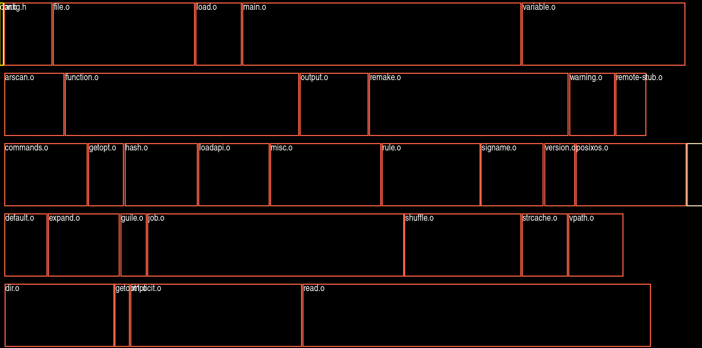

GNU MAKE profile viewer
=======================



Using profiling data from gmake-experimental's profile branch which is in a CSV format one can visualise how parallel the build was.

The profiling data is like this:

```
"Start Time (s)","Duration (s)", "Notional CPU", "File"
1791372520.308240, 0.023210, 0, "src/config.h"
1791372520.333809, 0.212541, 3, "src/default.o"
1791372520.331736, 0.238745, 0, "src/ar.o"
1791372520.332401, 0.296420, 1, "src/arscan.o"
1791372520.333166, 0.409818, 2, "src/commands.o"
1791372520.334380, 0.538256, 4, "src/dir.o"
1791372520.547363, 0.353141, 3, "src/expand.o"
```
