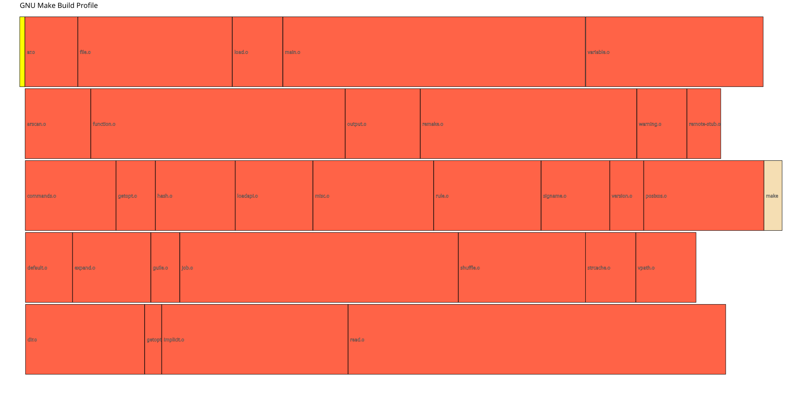
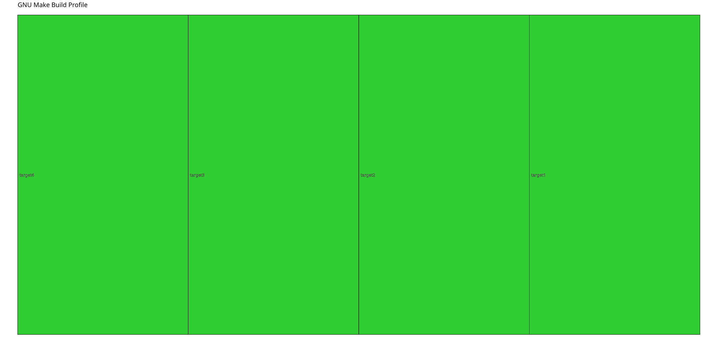
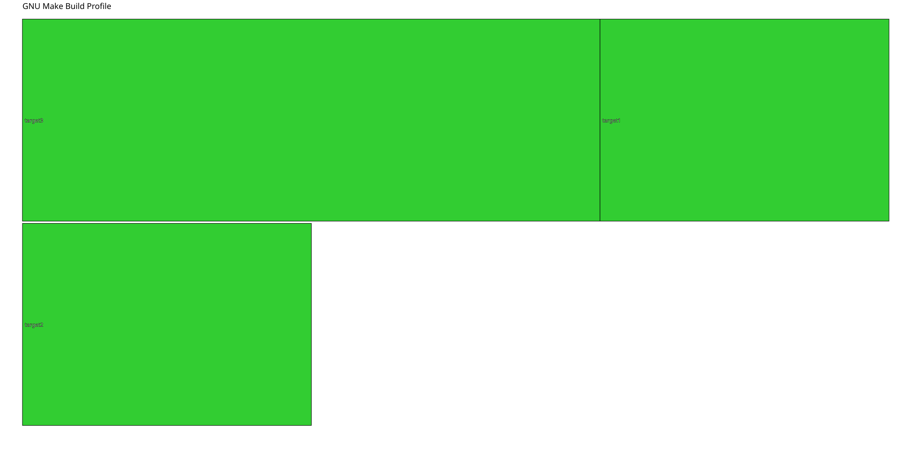

GNU MAKE profile viewer
=======================

Using profiling data from gmake-experimental's profile branch which is in a CSV format one can visualise how parallel the build was.


# The Profiling Data 
This data is generated from GNU Make  [gmake experimental](http://github.com/tnmurphy/gmake-experimental/tree/feature/profile)

```
"Start Time (s)","Duration (s)", "Notional CPU", "File"
1791372520.308240, 0.023210, 0, "src/config.h"
1791372520.333809, 0.212541, 3, "src/default.o"
1791372520.331736, 0.238745, 0, "src/ar.o"
1791372520.332401, 0.296420, 1, "src/arscan.o"
1791372520.333166, 0.409818, 2, "src/commands.o"
1791372520.334380, 0.538256, 4, "src/dir.o"
1791372520.547363, 0.353141, 3, "src/expand.o"
```

# Pygame Profile Viewer view of a build of GNU Make


# SVG Output from a Profile of a build of GNU Make


# A build with several serial tasks (run with gmake)
```make
all: target1


target1: target2
	sleep 1

target2: target3
	sleep 1

target3: target4
	sleep 1

target4: 
	sleep 1
```


# A build with 2 parallel tasks (built with gmake -j2)
```make
all: target1 target2


target1: 
	sleep 1

target2: 
	sleep 1
```


# A build with parallel tasks and a gap showing a period of non utilisation (gmake -j2)
```make
all: target1 target2


target1: target3
	sleep 1

target2: 
	sleep 1

target3: 
	sleep 2
```

